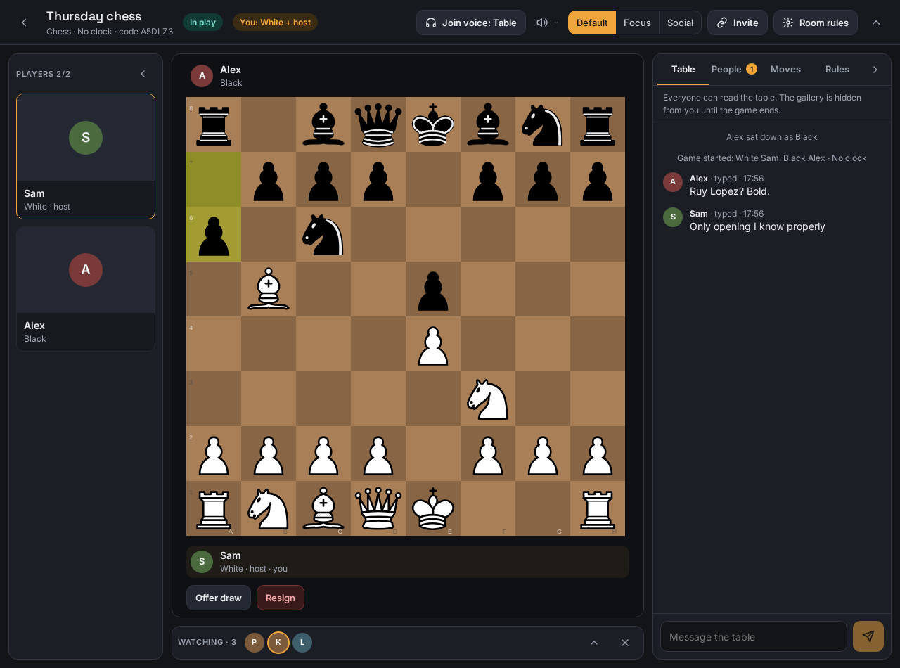
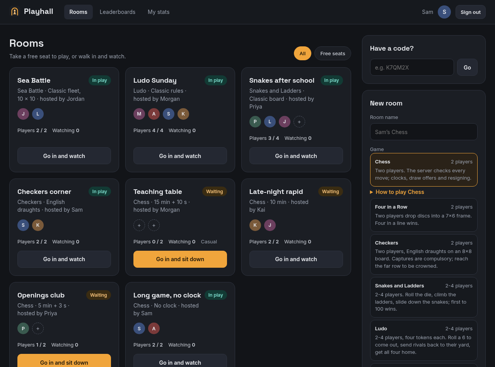
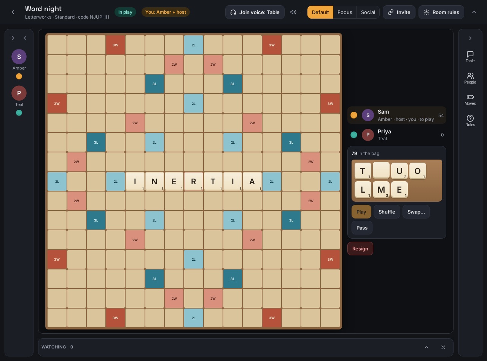
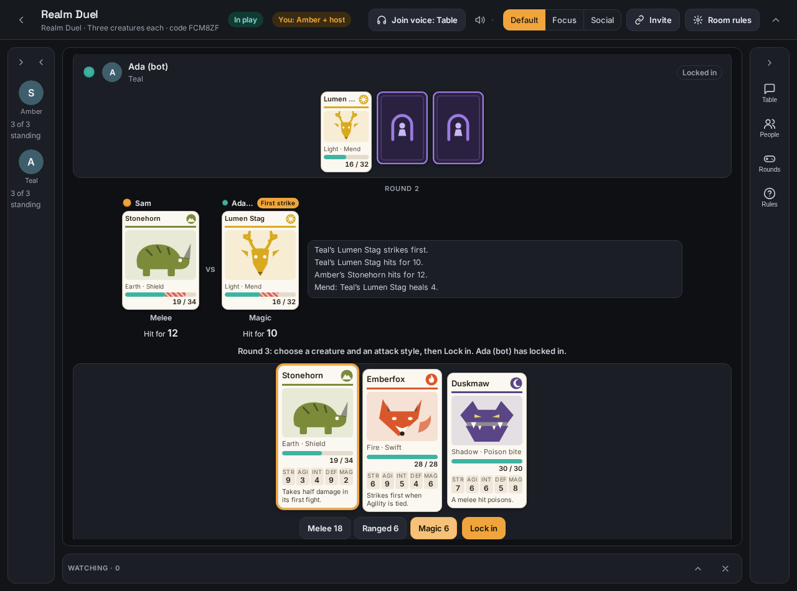
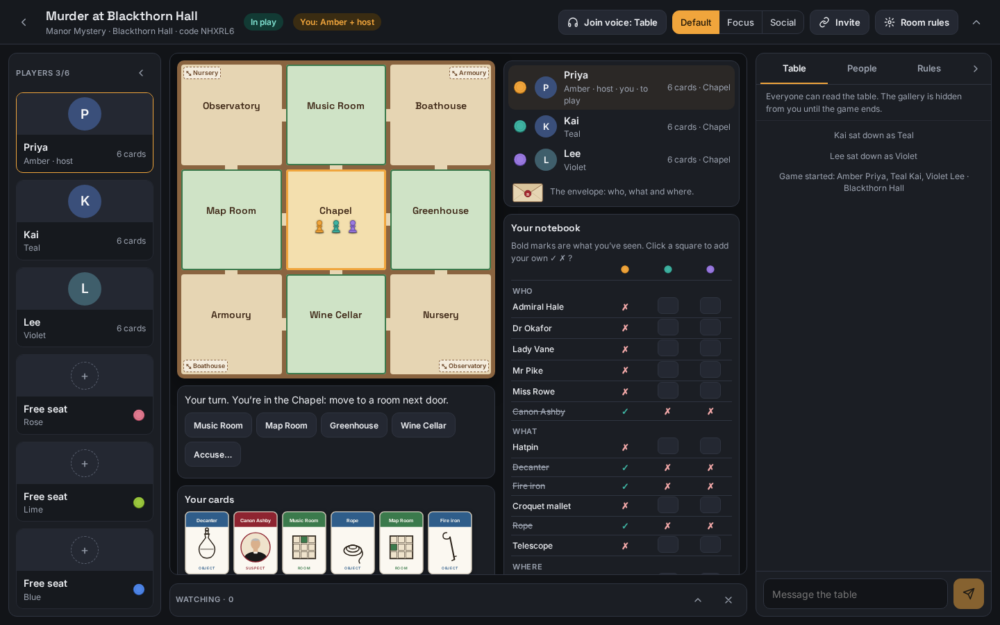
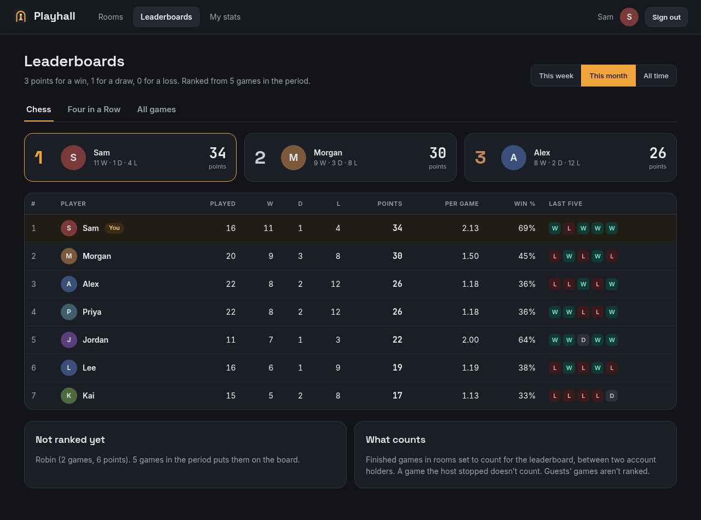

# Playhall

**Game rooms where a host invites people in, some of them play, and everyone
else pulls up a chair and watches.** Each room has a host, players (the game
decides how many seats) and watchers, with a table chat for everyone and a
gallery chat the players can't read during a game.

Fourteen games: chess, checkers, Four in a Row, Snakes and Ladders, Ludo, Sea
Battle, Blackjack, Colour Clash, Texas Hold'em, Letterworks (a crossword tile
game), Realm Duel (a creature card duel), Manor Mystery (a country-house
murder mystery), Ship2Shore (a WW2 hidden-role game for 5-11) and Who Dat?
(a guess-the-face game for two), drawn from
one shared kit of boards, pieces, cards, chips and dice
([docs/games.md](docs/games.md)), plus the **camera table** for any real
board game on your own table. Every game is a plug-in with its own
seats, rules and board, and the room around it stays the same. Rooms have voice
and video (self-hosted LiveKit) and optional transcripts. Next: sharing a game running on your own PC
with remote players using controllers, OpenBOR rooms run on the server
([docs/openbor.md](docs/openbor.md)), and web-game plug-ins. See
[docs/design.md](docs/design.md).

**More: the [project overview](https://github.com/chrisnock-personal/project-overviews/tree/main/playhall)**, with the whole tour in pictures.



<p>


</p>
<p>


</p>


## What works now

- **Accounts and guests.** Sign up with a username and password, or join from
  an invite link with just a display name. Hosting needs an account.
- **Rooms and roles.** Create a room, play in it yourself or just host. Free
  seats are open to anyone, or only to people the host seats; watchers ask for
  a seat and wait in a queue. After each game: same players, winner stays, or
  both rotate out; the players can start a rematch when they all agree (in
  rooms where anyone can sit).
- **Chess.** Moves are checked on the server; clocks with increments,
  draw offers, resigning, promotion, checkmate, stalemate, repetition and the
  50-move rule. The board is lichess's chessground.
- **Thirteen games**, each with its rules in a How to play tab, and replays of
  finished games (move by move, hidden cards staying hidden).
- **Chat.** Table (everyone reads it; watchers write only between games unless
  the host allows it) and Gallery (watchers only; hidden from players while a
  game is on).
- **The camera table** (with LiveKit). Any real board game: the host types
  its name, picks 2 to 8 seats and films the board with a phone on a stand
  (scan the code from the room's Table camera button; the phone needs no
  account and takes no seat). The board fills the stage for everyone; the
  room keeps whose turn it is, a dice roller rolled on the server (d4 to d20,
  every roll said in the chat), a score pad and the move timer. At the end
  the host enters the places and every player confirms them before it
  counts; a dispute means it doesn't. Leaderboards have a tab per game name.
- **Voice and video** (with LiveKit, the `media` compose profile). Join the
  table or the gallery, split like the chat; you join muted with your camera
  off. Push to talk, a talking ring, a volume per person. Players' cameras show
  on their seat cards; watchers' cameras show in the gallery strip only when
  the host allows it. With a watcher delay, watchers get neither the players'
  voice nor their video during play.
- **Transcripts** (optional; with `WHISPER_URL`). When the host turns them on,
  what people say in voice appears in the chat as "said" lines, with a clear
  notice for everyone in voice. Only the text is kept, never the audio. The
  admin can switch them off for the whole server.
- **Your settings.** Microphone, speakers and camera (pick one when you have
  several, with a level meter, a test sound and a preview), your password and
  the theme.
- **A room layout that gets out of the way.** The top bar, players, watchers
  and side panel each expand, shrink or hide; Default, Focus and Social
  layouts; your layout is remembered per game. Works on a phone.
- **Computer players** in every game but chess, Letterworks, Manor Mystery
  and the camera table. The host can put a bot in any
  free seat between games, so a small group can fill a bigger table. A bot
  plays from its own seat's view, exactly what a person there would see.
  Games with a bot don't count for the leaderboards.
- **AI players** (Ship2Shore so far; optional). A language model on a server
  the admin runs (an Ollama address, set on the Admin page) plays a seat: it
  makes the social moves (who to trust, votes, who goes to the sharks) and
  talks at the table, and the computer player's rules make the arithmetic
  moves and step in whenever the model is slow or wrong. Nothing is sent
  anywhere but that server.
- **Points, leaderboards and stats.** 3 points for a win, 1 for a draw, 0
  for a loss. Leaderboards for this week, this month and all time (ranked from
  5 games); each player's record, results as White and Black, points per
  week, how games ended, recent games and head-to-head records. When a game
  ends, the room shows the points, new totals, ranks and the head-to-head.
  Only games between account holders in rooms set to count are counted.
- **Private rooms.** A host can give a room a password; everyone else needs
  it to get in (the host and seated players don't). Changing it makes everyone
  else enter the new one.
- **Host rules.** Seat policy, guests playing, the after-game rule, time
  control, chat permissions, watcher cameras, listing in the lobby, closing
  the room.

## Run it

```bash
cp .env.example .env    # fill in POSTGRES_PASSWORD and JWT_SECRET
podman build -t localhost/playhall:latest .
podman-compose up -d --force-recreate
```

Then open https://localhost:8450 (an old `http://` link redirects there).
Playhall serves HTTPS by default, because browsers only allow microphones and
cameras over HTTPS: on first start it makes a self-signed certificate, kept in
the `playhall-certs` volume so redeploys don't change it. Each device accepts it
once (the browser's warning, then "proceed"). To use a real certificate,
upload it on the platform settings page (below), or put `server.crt` (the
certificate and any intermediates, PEM) and `server.key` in that volume and
send the app `SIGHUP` (`podman-compose kill -s HUP app`). Either way it checks
the pair and swaps it in with no restart.

**Platform settings.** Admins get a "Platform" link in the top bar
(`#/admin`): sign-ups and guests on or off, voice and video on or off, the
defaults for new rooms, the HTTPS certificate, making other accounts admins,
and closing any room. These are kept in the database and apply to everyone;
each person's own settings (devices, theme) stay on the Settings page. To get
the first admin: a fresh install makes the account **admin** with password
**admin** (or `ADMIN_PASSWORD`), which must choose its own password at its first
sign-in before anything else opens. Or create an account, then set `ADMIN_USERNAMES` to its username
and restart. List an account there only once it exists: while sign-ups are on,
anyone could otherwise create an account with that name and be an admin.

To try it with data (eight players, six rooms and two months of games; prints
the demo players' password):

```bash
podman-compose exec app node dist/server/demo.js            # load
podman-compose exec app node dist/server/demo.js --remove   # remove
```

Build with `podman build` before `podman-compose up`: `up --build` on its own
has left the old container running.

| Setting | Meaning |
|---|---|
| `POSTGRES_PASSWORD` | Database password (`python3 -c "import secrets;print(secrets.token_hex(24))"`) |
| `JWT_SECRET` | Signs sessions; at least 32 random characters or the server won't start |
| `ALLOW_SIGNUP` | `false` stops new accounts (guests still work). Only the starting value: once an admin changes it on the platform settings page, that wins |
| `ADMIN_PASSWORD` | The default admin's first password (default `admin`); it has to be changed at the first sign-in anyway |
| `ADMIN_USERNAMES` | Usernames that are always admins, comma-separated (e.g. `chris`). Admins can make other accounts admins on the platform settings page |
| `PLAYHALL_PORT` | Port on the host (default 8450) |
| `TLS` | `on` (default): HTTPS; `off`: plain HTTP, e.g. behind your own proxy that does HTTPS |
| `TLS_HOSTS` | Extra names or addresses for the self-signed certificate, comma-separated (e.g. `playhall.home,192.168.1.50`); localhost is always in it |
| `WHISPER_URL` | A whisper.cpp server (`POST /inference`) for transcripts, e.g. `http://host.containers.internal:8090`; empty = no transcripts. Playhall never starts its own |
| `TRANSCRIPTS` | `off` switches transcripts off on this server even with `WHISPER_URL` set. When on, each room's host decides (off by default); only the text is kept, never the audio |

## Develop

```bash
npm install
npm test                 # game rules and room engine
npm run typecheck
DATABASE_URL=postgres://... JWT_SECRET=... TLS=off npm run dev:server   # :8450
npm run dev:client       # Vite on :5173, proxying /api and /ws
node scripts/smoke.mjs http://localhost:8450   # end-to-end check against a running server
# (start the server with ADMIN_USERNAMES=smoke_admin and it tests the platform settings too)
node tests/browser.mjs http://localhost:8450   # the same in a real browser (Playwright)
node tests/browser.mjs http://localhost:8450 firefox   # or webkit (npx playwright install firefox webkit)
NODE_TLS_REJECT_UNAUTHORIZED=0 node tests/voice.mjs https://localhost:8450   # voice, fake mics (needs LiveKit)
NODE_TLS_REJECT_UNAUTHORIZED=0 node tests/video.mjs https://localhost:8450   # video, fake cameras (needs LiveKit)
NODE_TLS_REJECT_UNAUTHORIZED=0 node tests/cameratable.mjs https://localhost:8450   # the camera table: a phone as table camera, dice, results (needs LiveKit)
NODE_TLS_REJECT_UNAUTHORIZED=0 node tests/transcripts.mjs https://localhost:8450   # speech to said lines (needs LiveKit and WHISPER_URL)
npm run demo             # demo data into DATABASE_URL (--remove to take it out)
```

CI (`.github/workflows/ci.yml`) runs the typecheck, unit tests, build, the
end-to-end and browser tests against a real Postgres, loads and removes the
demo data, audits runtime dependencies and scans for secrets; a second job
builds the image and runs it with compose. A `v*` tag publishes a multi-arch
image to `ghcr.io/chrisnock-personal/playhall` once CI has passed on that
commit.

## Layout

```
src/shared/game.ts         the contract every built-in game implements
src/shared/games/chess.ts  chess (chess.js), with clocks and draw offers
src/shared/protocol.ts     room settings, snapshots and WebSocket messages
src/server/rooms/room.ts   one room: roles, seats, queue, chat, game lifecycle
src/server/rooms/manager.ts loading, saving and unloading rooms
src/server/ws.ts           /ws: one snapshot per person after each change
src/server/stats.ts        results, leaderboards, a player's stats
src/server/platform.ts     platform settings (the admin's), cached from the database
src/server/admin.ts        /api/admin: settings, certificate, admins, closing rooms
src/server/demo.ts         demo data (load / --remove)
src/client/room/           the room layout and its collapsible panels
src/client/games/          each game's stage, side-panel tab and settings
migrations/                numbered SQL, applied at start-up
brand/                     the logo (a pawn walking into the hall) and icons
```

## Licence

GPL-3.0-only. See [LICENSE](LICENSE).
